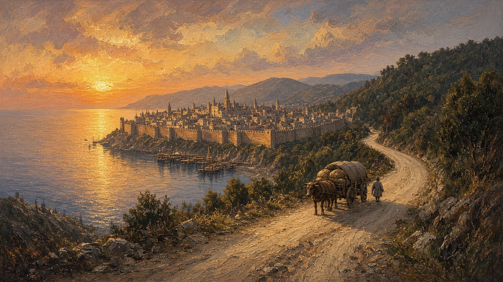

# Flechas de goblin

Lê isto em voz alta. As fotos só abrem no clique.

**Muestra** os dois.

> El carro avanza rodando y las ruedas marcan el ritmo sobre el camino. A su lado viajan Gundren Buscapiedras y Sildar. Gundren es famoso en el Norte igual que un trueno: todo el mundo lo oye, nadie lo invitó y la taberna se alegra cuando entra. Hoy su plan inmediato cabe en el carro: comida para el pueblo de Phandalin. Lo otro va dentro de un tubo de mapas en su cadera, y de eso todavía no habla.
>
> El trato ya está cerrado. Diez monedas de oro para cada uno si la carga llega completa: harina, cerdo salado, cerveza, queso, pan, faroles y aceite. Todo el cargamento vale unas cien monedas de oro, y Gundren no tiene ninguna prisa en que se pongan a contarlas.
>
> Sildar, de capa azul, tiene cara de haberse arrepentido en el primer cuarto de legua y de haber seguido caminando solo por terquedad.
>
> —Aquí se bajan —dice Gundren, y les deja en la mano una piedra gris de río, marcada con una muesca—. Neverwinter es gigante y yo soy chaparro, así que escuchen bien: taberna El Yunque Alegre, en la calle del puerto. El cartel es un yunque riéndose de ustedes. Dejen la piedra a la vista en la mesa. Doña Sera Calder no busca caras; busca esa piedra. Duermen ahí esta noche. Al amanecer sale el carro, y ella va en el pescante.
>
> Sildar ni siquiera los saluda.
>
> —Y por favor, no se coman la piedra —añade Gundren—. Si lo hacen, no los voy a buscar.
>
> Gundren y Sildar montan en el carro y el vehículo sigue en marcha, dejando atrás el tramo inicial mientras el tubo del mapa golpea contra la cadera del enano.

**Muestra** a cidade.

> Al doblar la cuesta, Neverwinter aparece entera frente a ustedes y parece enorme hasta para el viento.
>
> Las torres se amontonan sobre la colina como si un rey se hubiera puesto todas las coronas a la vez y mirara quién parpadea primero. Hay murallas de piedra vieja, un río que corta la ciudad en dos y un puerto allá abajo lleno de mástiles y humo. El bosque se abre y el camino baja directo hacia la puerta principal.
>
> Desde aquí arriba parece una postal épica. De cerca va a oler a pescado, a soga mojada y a alguien cobrando por mirar. Disfruten la vista mientras dure: dura lo que tarda un enano en abrir la boca.
>
> La ciudad queda abajo. La piedra pesa poco, pero ya es un compromiso. ¿Bajan hacia el puerto o se quedan mirando el paisaje?

## Ordem

| | |
|---|---|
| [00](historia-principal/00-sera-e-relogio.md) | Relógio. Deixa aberto. Não leias à mesa. |
| [01](historia-principal/01-alba-neverwinter.md) | Noite, Sera, alba |
| [02](historia-principal/02-emboscada.md) | Senda de Triboar |
| [03](historia-principal/03-senda.md) | Rastro e armadilhas |
| [04](historia-principal/04-area-1-boca.md) | Boca |
| [05](historia-principal/05-area-2-vigias.md) | Vigias |
| [06](historia-principal/06-area-3-perrera.md) | Lobos |
| [07](historia-principal/07-area-4-pasaje.md) | Passagem |
| [08](historia-principal/08-area-5-puente.md) | Ponte |
| [09](historia-principal/09-area-7-tanques.md) | Tanques |
| [10](historia-principal/10-area-6-sera.md) | Sera e Yeemik |
| [11](historia-principal/11-area-8-klarg.md) | Klarg |
| [12](historia-principal/12-phandalin.md) | Phandalin |

Decisões, só quando a saída o disser: [mapa](decisoes/00-mapa.md).

Lâminas: [ONDE-USAR](laminas/ONDE-USAR.md). Nas lutas da caverna, a sala é a arma. A regra está em **Objetos no combate**. Não a leias.
