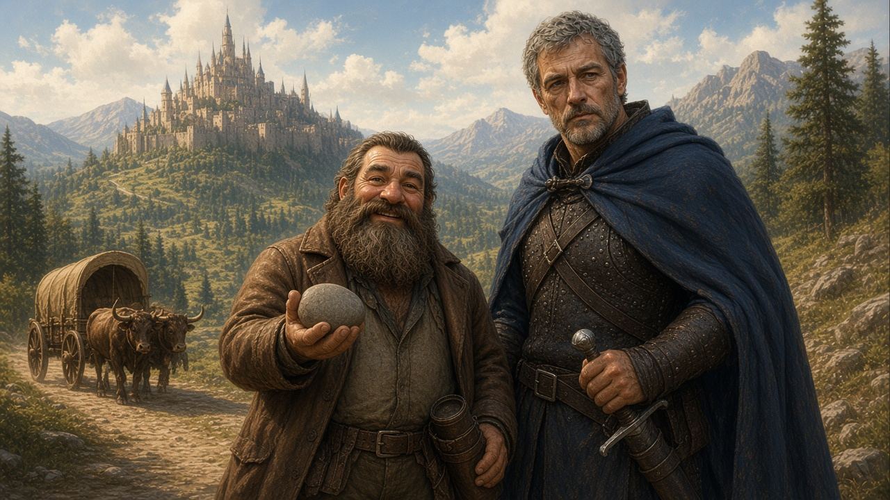

# Flechas de goblin

Lê isto em voz alta. É a abertura, no alto da encosta, antes da taberna. As fotos só abrem no clique.

**Muestra** a cidade.

> Desde esta cuesta, Neverwinter no cabe en la boca.
>
> Las torres se apilan como si un rey se hubiera puesto todas las coronas y se hubiera sentado en la colina a ver quién pestañea primero. Murallas de piedra vieja. Un río que parte la ciudad. El puerto, allá abajo, suelta humo y mástiles. El bosque se aparta del camino, y el camino, muy educado, baja hacia la puerta.
>
> De aquí parece un juramento. De cerca va a oler a pescado, a cuerda mojada y a alguien que cobra por mirar. Disfruten el juramento. Dura lo que tarda un enano en abrir la boca.

**Muestra** os dois. O anão estende a pedra. O guerreiro já está arrependido.

> Gundren Buscapiedras es famoso en el Norte del mismo modo que un trueno: todo el mundo lo oye, nadie lo invitó, y la taberna sonríe cuando entra. Hoy su objetivo cabe en un carro. Comida para Phandalin. El otro objetivo viaja en el tubo del mapa, y de ese no habla. Todavía.
>
> El carro ya es de ustedes. Dijeron que sí. Diez piezas de oro por cabeza si la carga llega entera. Harina, cerdo salado, cerveza, queso, pan, faroles y aceite. Cien piezas, si alguien quiere contarlas. Gundren no va a dejar que las cuenten.
>
> Para junto a la carreta. Sildar, capa azul, tiene cara de haberse arrepentido en el primer cuarto de legua y de haber seguido igual.
>
> —Aquí se bajan —dice Gundren, y les pone en la mano una piedra gris, de río, con una muesca—. Neverwinter es enorme y yo soy bajito, así que escuchen una sola vez. Taberna El Yunque Alegre, calle del puerto. El letrero es un yunque riéndose de ustedes. Pongan la piedra en la mesa. No la escondan. Doña Sera Calder no busca caras. Busca la piedra. Pasan la noche ahí. Al alba sale el carro, y ella va en el pescante.
>
> Sildar ni saluda.
>
> —Si se comen la piedra, no los busco.
>
> Dos caballos. El tubo del mapa golpea la cadera del enano. Bajan la cuesta sin ustedes.
>
> La ciudad queda abajo. La piedra pesa poco y obliga mucho. ¿Bajan ya, o se quedan a discutir con el paisaje?

## Agora

Abre o [00](historia-principal/00-sera-e-relogio.md) e deixa-o aberto. Não o leias. A noite, a pedra na mesa e a **Sera** estão na [01](historia-principal/01-alba-neverwinter.md).

## Ordem

| | |
|---|---|
| [00](historia-principal/00-sera-e-relogio.md) | Relógio. Deixa aberto. Não leias à mesa. |
| [01](historia-principal/01-alba-neverwinter.md) | Noite, Sera, alba |
| [02](historia-principal/02-emboscada.md) | Senda de Triboar |
| [03](historia-principal/03-senda.md) | Rastro e armadilhas |
| [04](historia-principal/04-area-1-boca.md) | Boca |
| [05](historia-principal/05-area-2-vigias.md) | Vigias |
| [06](historia-principal/06-area-3-perrera.md) | Lobos |
| [07](historia-principal/07-area-4-pasaje.md) | Passagem |
| [08](historia-principal/08-area-5-puente.md) | Ponte |
| [09](historia-principal/09-area-7-tanques.md) | Tanques |
| [10](historia-principal/10-area-6-sera.md) | Sera e Yeemik |
| [11](historia-principal/11-area-8-klarg.md) | Klarg |
| [12](historia-principal/12-phandalin.md) | Phandalin |

Decisões, só quando a saída o disser: [mapa](decisoes/00-mapa.md).

Lâminas: [ONDE-USAR](laminas/ONDE-USAR.md). Nas lutas da caverna, a sala é a arma. A regra está em **Objetos no combate**. Não a leias.
