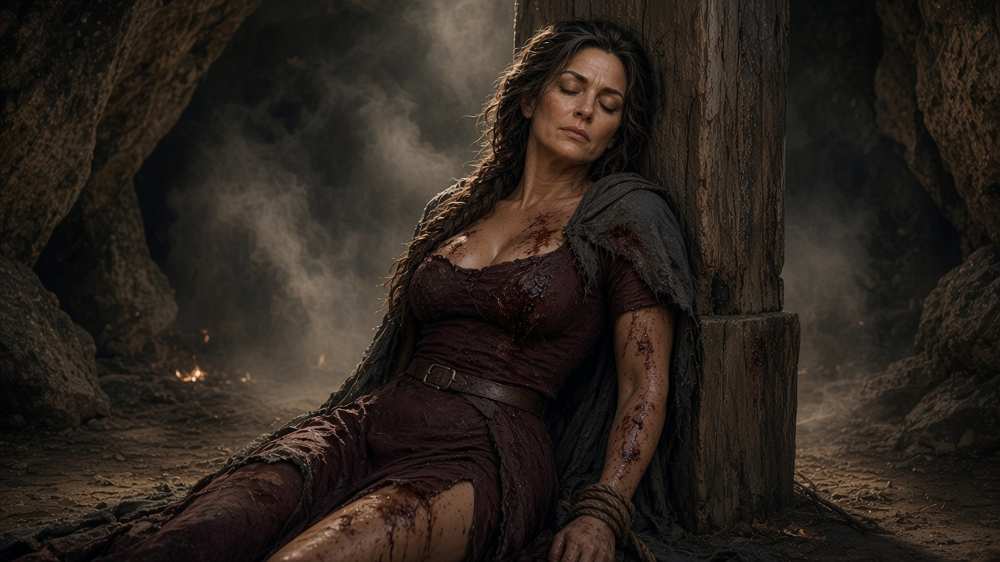

# Viva ou morta

**Dispara:** [A Journey in the Dark](https://www.youtube.com/watch?v=MW5w0-xOXu8). **Fundo, bem baixo:** [The Underdark](https://sounds.tabletopaudio.com/170_The_Underdark.mp3). Não troques.

**Identidade:** chegaram tarde. O fogo ainda arde. Ela já não.

Só se o relógio está em **0**. Se ainda há marcas, não leias esta página. O diálogo está na [área 6](../historia-principal/10-area-6-sera.md).

## Primeira impressão

**Muestra** a lâmina antes do texto. Ela está no poste.

> Cuando levantáis la vista, Sera ya no está de pie.
>
> Su cuerpo cuelga del poste, sujeto por las ataduras que le mantienen los brazos levantados. La cabeza cae hacia delante y su trenza, ahora deshecha y cubierta de sangre, le oculta parte del rostro.
>
> Su vestido burdeos está rasgado y empapado. La tela se pega a las heridas de su pecho y sus costados. Tiene cortes profundos en los brazos, marcas de golpes en el rostro y una herida abierta en el muslo. Una de sus botas ha desaparecido. La otra apenas se mantiene sujeta al pie.
>
> La sangre ha caído por el poste y se ha mezclado con la tierra bajo sus pies. Hay manchas oscuras en el suelo y salpicaduras en las piedras cercanas.
>
> No parece que los goblins hayan tenido prisa. Han dejado sus lanzas clavadas alrededor del poste, como si hubieran preparado una exhibición. Uno de sus escudos descansa junto a una calavera. Otro tiene manchas de sangre seca.
>
> La trenza de Sera sigue llevando el pequeño cordón de cuero que sujetaba su cabello cuando la conocisteis.
>
> El fuego verde continúa ardiendo al fondo. Su luz ilumina el cuerpo de Sera, pero no llega a calentar la cueva.
>
> No hay movimiento. No hay respiración.
>
> Sera Calder está muerta.
>
> Yeemik se limpia la hoja de su cuchillo con un trozo de la túnica de Sera. Después levanta la mirada hacia vosotros.
>
> —Demasiado lentos.
>
> Durante unos segundos, nadie dice nada.
>
> Los cinco goblins que permanecen abajo han dejado de reír. Uno de ellos mira el cuerpo y después a vosotros. Otro retrocede un paso.
>
> Yeemik sonríe.
>
> —¿Queríais salvarla? Ahora podéis llevaros lo que queda.
>
> El cuerpo de Sera sigue colgado del poste.

## O ambiente

- O fogo verde fica ao fundo. Não está nela.
- A sala está mais quieta do que quando entraram. O fumo continua.

## Pontos de interesse

Se a empurraram ainda viva, noutro momento, não saltes para este texto. Primeiro: 1d6, cai a 0, três rounds para estabilizar.

## Interações

- Descer o corpo, ou subir até ele. Não há trato.

## Informação do mestre

- **Yeemik** tem 12 pontos. Os cinco e ele lutam.
- Podem levar o corpo. As caixas continuam com **Klarg**.

## Transição

O final é o velório de [Phandalin](../historia-principal/12-phandalin.md).
