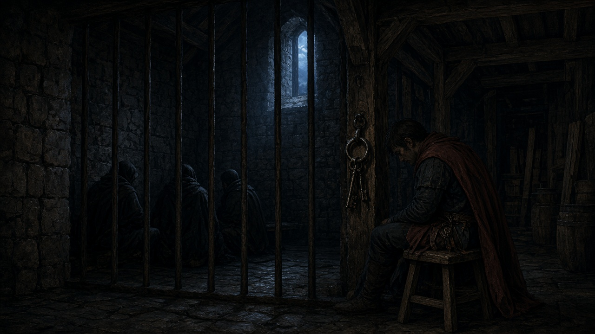

# Decisão — Phandalin os prende

História alternativa. Usa isto só se abandonaram a Sera e seguiram até a vila com o carro vazio.

Não abras as áreas da caverna. O relógio, se algum dia voltarem, já está em 0.

Chegam com bois, carro sem caixas, e sem doña Sera. Um lenhador viu-os na senda. Barthen esperava a sócia e a comida do povo. Harbin Wester, o alcaide, precisa de um culpado antes que a praça se volte contra ele.

---

## Parte 1 — A acusação

Portada do ramo: [c-prisao.jpg](../laminas/portadas/c-prisao.jpg). Na praça, o rosto de [Harbin](../laminas/personagens/p-harbin.jpg).

**Muestra** a lámina da cela quando a porta fechar. Na cela, [Pip](../laminas/personagens/p-pip.jpg). Na fuga, a paisagem [l-noite-vila.jpg](../laminas/paisagens/l-noite-vila.jpg).

> No hay juicio. Hay una sala de madera, dos guardias cansados y unas barras de hierro bajo el ayuntamiento. Harbin no los mira a los ojos. «Al amanecer dirán, delante del pueblo, qué hicieron con doña Sera y con el carro.» La puerta cierra. Arriba, alguien arrastra un banco. Abajo se quedan con un joven guardia, Pip, que se duerme en el taburete con las llaves colgando.

Harbin não quer a verdade. Quer a praça calada até de manhã. Barthen está zangado e assustado. Acredita que abandonaram a Sera. Não é um vilão: é um homem a quem falta a sócia.

---

## Parte 2 — Sair da cela

Uma saída basta. Deixa o grupo procurar. Se emperram, Pip ressona alto e as chaves batem na fivela.

1. **Convencer Pip.** Persuasão CD 12. Ele ouviu goblins na senda e não acredita na história do roubo. Abre se prometem voltar a procurá-la. Cumprir ou não já é deles.
2. **Tirar as chaves.** Prestidigitação CD 13 enquanto ele dorme. Se falham por 5 ou mais, acorda e grita.
3. **O varão podre.** Atletismo CD 15 e saem pelo postigo. Fazem barulho. Pip acorda. Há perseguição até a horta.

Se ainda estão presos ao amanhecer, Harbin leva-os à praça. Falar custa então +2 na CD. A multidão quer as caixas, não a explicação.

---

## Parte 3 — A fuga

Se saem de noite:

> Corren entre coles y cercas. Detrás, dos antorchas. Delante, el camino oscuro a Neverwinter. En la cresta del este arde una fogata que no es de pastores: verde, breve, de goblin. Phandalin encerró a los únicos que podían haber vuelto a esa cueva. La ciudad queda atrás. La fogata no.

Perseguição: Furtividade em grupo CD 12, ou um round de corrida e perdem-se no campo.

A história alternativa fecha aqui. Ficam foragidos, com a caverna ainda acesa na colina.

Se mais tarde quiserem entrar na caverna mesmo assim, a Sera já está na lámina da morte e Klarg continua com as caixas. Aí sim voltas à [área 1](../historia-principal/04-area-1-boca.md), com o relógio em zero.
