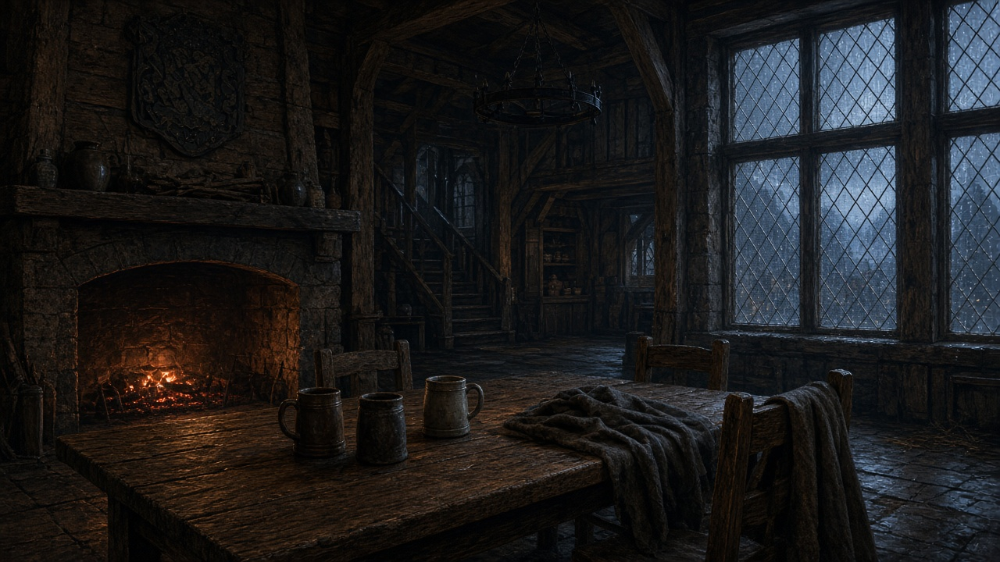
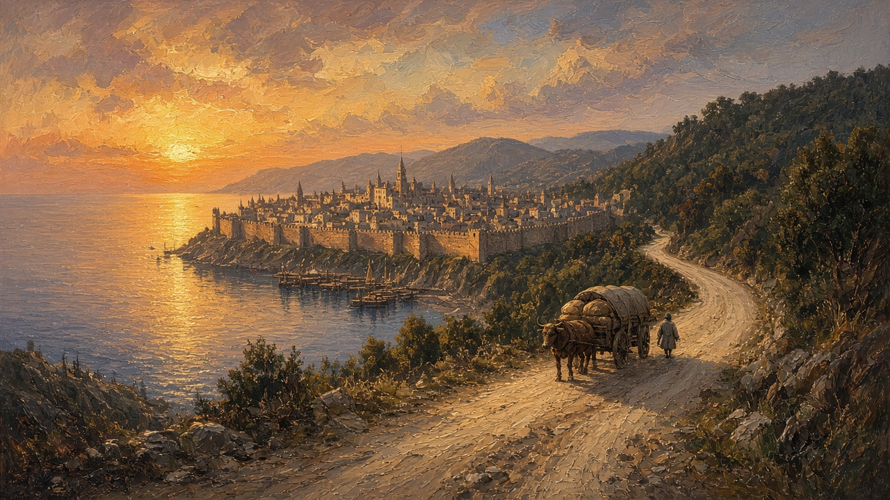

# 01 — A noite e o alba

**Objetivo:** que eles conheçam a **Sera** à mesa, durmam na taberna, e saiam com ela ao alba.

## Entrada

**Muestra** a taberna enquanto ainda é noite.

> La lluvia corre por el cristal. Dentro, la leña cruje y la mesa huele a cerveza y a estofado. Un enano de barba gruesa deja tres monedas junto a las jarras y se sienta sin pedir permiso.
>
> —Gundren Buscapiedras —dice—. Mañana el carro sale a Phandalin. Diez piezas de oro para cada uno, si la carga llega. Yo me voy esta noche, con Sildar. Ustedes salen al alba.
>
> Empuja la puerta de la cocina con la bota. Entra una mujer. Vestido burdeos, justo, escote bajo, la falda abierta en un muslo. La capa gris le cuelga de los hombros. No lleva ni un anillo.
>
> —Doña Sera Calder —dice Gundren—. La comida del pueblo es suya. Si el carro se pierde, se pierde con ella.

Se olham para o anão, **muestra** o [Gundren](../laminas/personagens/p-gundren.jpg). Se perguntam pelo guerreiro, [Sildar](../laminas/personagens/p-sildar.jpg) está à porta, capa azul, e só levanta a mão. Já vai sair.

**Muestra** a [Sera](../laminas/personagens/p-sera.jpg) quando ela falar.

> Sera apoya una mano en el respaldo de una silla. Los mira uno por uno.
>
> —No soy un fardo. Viajo en el pescante. Si algo sale mal en el camino, no suelten las riendas… ni a mí. Esta noche duermen aquí. El carro está en el patio, con dos bueyes y un muchacho que no se duerme si le pagan la cena.
>
> Gundren se levanta. El tubo de mapas le golpea la cadera.
>
> —Al alba, Phandalin queda a dos días por la Senda de Triboar. Nos vemos allí.
>
> La puerta se cierra. Afuera, dos caballos se alejan sobre las piedras mojadas. El fuego baja. Las jarras quedan vacías. Arriba, las camas crujen y la lluvia sigue.

De manhã, tira a taberna. **Muestra** a portada e depois a saída.

> El sol apenas tiñe de naranja los muros cuando las ruedas crujen sobre los adoquines. El aire huele a pan, a salitre y a buey. Sera ya está en el pescante. La capa gris sobre el burdeos. Las riendas en las manos. Los nudillos, blancos.
>
> Atrás van los sacos, la carne salada, la cerveza, el aceite y los faroles.
>
> Ella los mira por encima del hombro.
>
> —Gundren lleva horas de ventaja. El pueblo espera esta comida. ¿Cómo viajan? ¿Conmigo, abriendo camino, o cerrando atrás?

## Diálogos, se falarem na noite

- Se perguntam o que há no carro: «Harina, cerdo, cerveza, queso, pan, faroles y aceite. Cien piezas de oro, si alguien quiere contarlo. Yo no pienso dejar que lo cuenten.»
- Se perguntam por Gundren: «El enano encontró algo en las colinas. No es asunto de esta mesa. El asunto es que el carro llegue.»
- Se oferecem para ir já: «De noche, la Senda se come a los listos. Duerman. Yo vigilo el patio hasta el segundo vaso.»
- Sildar, se o travam à porta: «Si Gundren corre, yo corro con él. Ustedes cuidan de ella. Es más terca que el enano.»

## O que há aqui

- Conduzir o carro não pede rolagem. A ordem de marcha é a pergunta dela.
- **Sera**, 41 anos. Não combate. Orgulhosa. Não larga a carga.
- **Gundren** e **Sildar** saem nesta noite. Não voltam nesta história.
- Carga: **100 po**. Pagamento na entrega: **10 po** cada um, pagos por **Barthen**.

## Saída

Eles respondem à pergunta dela, ou sobem para o carro em silêncio. A estrada abre. Sem encontro até o meio-dia. A seguir, [02](02-emboscada.md).
