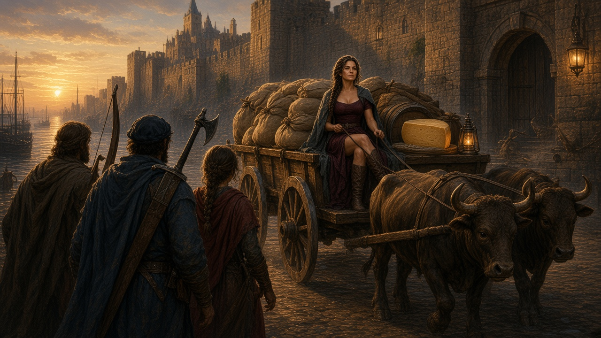

# 01 — Alba em Neverwinter

Portada, antes de tudo: [c-partida.jpg](../laminas/portadas/c-partida.jpg).

Dentro da taberna, ainda sentados: [l-taverna.jpg](../laminas/paisagens/l-taverna.jpg).

Se perguntam quem os contratou, mostra [Gundren](../laminas/personagens/p-gundren.jpg). O guerreiro que foi com ele é [Sildar](../laminas/personagens/p-sildar.jpg). Os dois já não estão na cidade.

**Muestra** a lámina da saída antes de ler. O retrato da Sera está em [p-sera.jpg](../laminas/personagens/p-sera.jpg).

A noite anterior já aconteceu: na taberna, Gundren contratou o grupo para escoltar o carro até Phandalin. Ele e Sildar partiram a cavalo. Sera ficou com a carga.

Conduzir o carro não pede rolagem. Pergunta a ordem de marcha: quem conduz, quem vai à frente, quem fecha.

Deixa cada jogador dizer quem é, numa frase, enquanto a cidade fica para trás.

## Ler em voz alta

> Neverwinter todavía está azul. La puerta de la taberna suelta un último golpe de luz sobre las piedras mojadas, y el calor se queda atrás. Dos bueyes esperan. El carro va cargado de sacos de harina, carne salada, barriles de cerveza, pan, empanadas, queso de cabra, faroles y un barril de aceite. Doña Sera Calder está junto a la rueda. El vestido burdeos le marca el cuerpo, el escote es bajo, la falda se abre en un muslo, y la capa corta le cae de los hombros. No lleva joyas. Los mira como quien ya decidió fiarse.
>
> «Gundren dijo que el camino es de dos días. Si los bueyes no se emperran, pasado mañana comemos en Phandalin. Yo voy en el carro. Ustedes alrededor. Si algo sale mal, no abandonen la carga… ni a mí.»

## Seguir

Viagem sem encontro até o meio-dia da Senda de Triboar. Abre [02 — Emboscada](02-emboscada.md).
