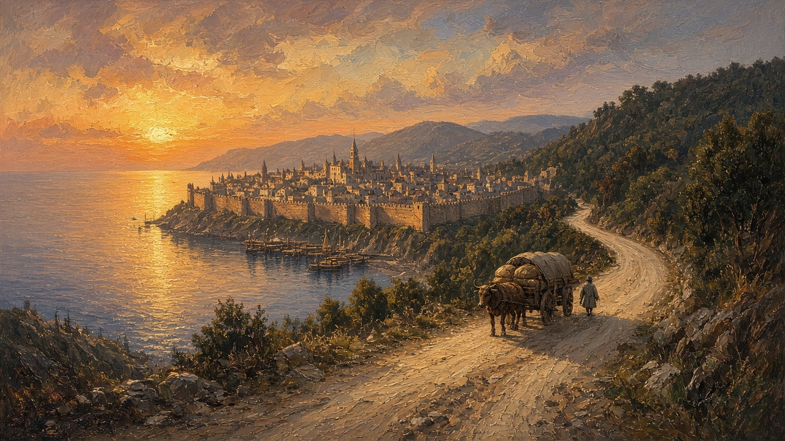

# 01 — Neverwinter

**Dispara:** [Heart of Courage](https://www.youtube.com/watch?v=LRLdhFVzqt4), quando a cidade aparece. **Fundo, bem baixo:** [Medieval Town](https://sounds.tabletopaudio.com/56_Medieval_Town.mp3).

**Identidade:** a cidade inteira, vista de cima. Ainda não entraram.

O carro já se foi. A [taberna](01B-taberna-el-yunque-alegre.md) só depois de descerem.

## Primeira impressão

**Muestra** a cidade. Silêncio curto antes disto.

> Al llegar a lo alto de la cuesta, Neverwinter aparece frente a ustedes.
>
> La ciudad es enorme. Sus murallas rodean edificios de piedra, altas torres y calles llenas de movimiento. A lo lejos, un río atraviesa la ciudad y desemboca en un puerto repleto de barcos.
>
> Se pueden ver comerciantes descargando mercancías, guardias vigilando las entradas y viajeros que llegan de todos los rincones de la región.
>
> Desde aquí, Neverwinter parece una ciudad impresionante. Aunque, viendo el tráfico de carros, los comerciantes gritando y el humo que sale de las chimeneas, probablemente también sea un lugar bastante ruidoso.
>
> El camino desciende directamente hacia la entrada principal. Más abajo se encuentra el puerto, donde está la taberna que Gundren les ha indicado.
>
> Tienen una dirección, una piedra que no deben perder y una recompensa de diez monedas de oro esperándolos al final del viaje.
>
> ¿Qué hacen? ¿Bajan directamente hacia la ciudad o prefieren detenerse un momento a observar Neverwinter?

## Transição

Quando descerem, abre a [taberna](01B-taberna-el-yunque-alegre.md).
