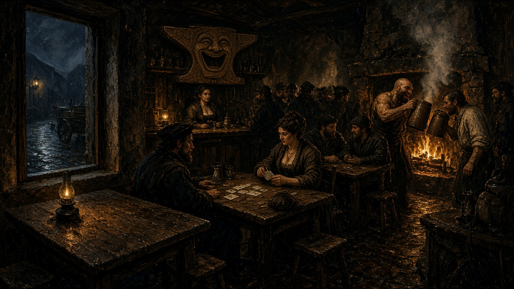
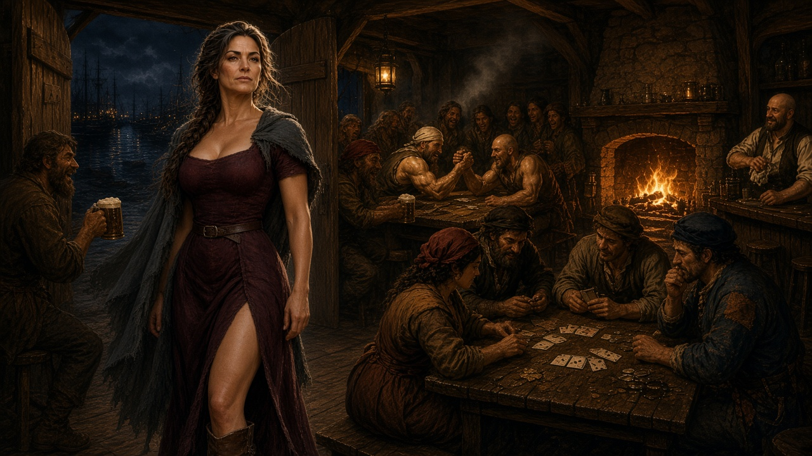

# 01B — Taberna El Yunque Alegre

Eventos secundários, enquanto a noite corre. A **Sera** entra quando quiseres puxar a missão.

## Entrada

**Muestra** a taberna. Há gente.

> La puerta de El Yunque Alegre chirría al abrirse y los recibe con una ola cálida de humo de pipa, grasa asada, cerveza derramada y risas mezcladas con murmullos. El letrero de afuera, un yunque con una mueca burlesca, parece haberles dado la bienvenida.
>
> En una esquina, un grupo ruidoso golpea la mesa con jarras espumosas mientras cuenta cuántas rondas lleva cada uno. Un par ya tiene los ojos vidriosos y la lengua trabada. En otra mesa, cerca del hogar, cuatro parroquianos inclinan la cabeza sobre un mazo de cartas manchado de vino, y cambian miradas sospechosas y monedas que tintinean. Más al fondo, sobre un tablón grueso, dos tipos de brazos gruesos se aferran de las manos con los codos clavados en la madera, rodeados por un corro que grita y apuesta.
>
> El tabernero seca un vaso sin mirar y les señala unas mesas libres al pasar. Pueden acomodarse, pedir algo, observar a los parroquianos o meter las narices en cualquiera de esos juegos mientras esperan que avance la noche.
>
> ¿Qué hacen primero?

A pedra fica à vista na mesa. O carro já está no pátio, com dois bois e um rapaz que não dorme se lhe pagam o jantar.

## Eventos secundários

Deixa-os escolher se interagem, apostam ou só observam. Cada evento pode render umas moedas, uma pista leve ou confusão, antes de a **Sera** aparecer.

### 1. Apostando quem bebe mais

- **Toma-Jarras**, marinheiro alto, careca, gargalhada fácil. **Bramido**, trabalhador do porto, barba rala, camisa suja de fuligem.
- Cada rodada: Constituição. CD 10 na primeira, 12 na segunda, 14 na terceira, e sobe de dois em dois.
- Falhar: Envenenado durante 1 hora (desvantagem em ataques e em testes), ou desmaia na mesa. Água ou um descanso tira o veneno.
- Aposta típica: 2 a 5 po por cabeça, ou uma informação sobre a estrada de **Phandalin**.

> —¡Vamos, forasteros! —ruge Bramido, empujando dos jarras oscuras hacia ustedes—. ¡Quien aguante tres rondas sin vomitar en las botas se lleva cinco monedas de oro y el respeto del muelle!

### 2. Jogando cartas

- **Marta «La fina»**, dedos ágeis, sorriso calmo. **Garra**, taciturno, cicatriz no queixo, vê tudo e cala.
- Uma rodada, 1 a 10 po.
- Enganação ou Prestidigitação CD 13 para mexer no jogo. Intuição CD 12 para ver que a **Marta** blefa, ou que o **Garra** marca as cartas.

> —Las cartas no mienten, señores —dice Marta barajando con un chasquido seco—. Solo miente quien las mira con miedo. ¿Entran con dos monedas o vienen solo a hacer sombra?

### 3. Tirando braço de ferro

- **Torvo**, estivador enorme, antebraços como troncos, tatuagem de âncora. **Rápido**, magricela, recolhe o dinheiro da roda.
- Força (Atletismo) disputada. Para uma queda longa, Constituição disputada.
- Vencer por 5 ou mais: dobra a aposta. Perder feio: o público zoa, e o **Rápido** puxa outra aposta para a revanche.

> —¡Codo en la mesa y cero lloriqueos! —gruñe Torvo, extendiendo una mano callosa—. Si tumban mi brazo antes de que cuente diez, el bote es suyo. Si les tiembla el pulso… pagan la próxima ronda de todos.

## Chegada

Quando já tiverem jogado, ou quando quiseres puxar o fio, a **Sera** entra.

> La puerta vuelve a abrirse y el murmullo de la taberna baja un tono.

**Muestra** a entrada. Tom: cine, presença firme.

> Entra doña Sera Calder, de cuarenta y un años, de piel oliva, hombros anchos y paso firme. Lleva una trenza castaña con canas cayendo a un lado, un vestido burdeos ajustado de escote bajo, manga corta y abertura en el muslo, ceñido con un cinturón de cuero y rematado con una capa gris corta caída sobre los hombros. Calza botas gastadas y no lleva ni una joya.
>
> Avanza sin prisa hasta la mesa de ustedes, con las manos sueltas, y clava los ojos castaños en la piedra gris con la muesca que dejaron a la vista. Por un instante el silencio pesa más que la cerveza derramada, hasta que suelta el aire despacio y toma asiento frente a ustedes.
>
> —Así que ustedes son los escoltas —dice con voz serena y directa—. Soy Sera Calder, socia de Provisiones de Barthen en Phandalin. Gundren y Sildar ya se fueron con el mapa, rumbo al Castillo Cragmaw, para el rey Grol… y yo no pienso dejar este carro en manos de desconocidos. Mañana al alba salimos con la comida del pueblo, y yo voy en el pescante. ¿Listos para ganarse esas diez monedas?

- Se alguém ficou bêbado no concurso, ela lança um olhar curto de reprovação. Não cancela o trabalho. Avisa que ao amanhecer os quer firmes.
- Se a pedra não está na mesa, ela não os reconhece e o carro não sai com eles.

## Saída

A manhã está na [01](01-alba-neverwinter.md).
