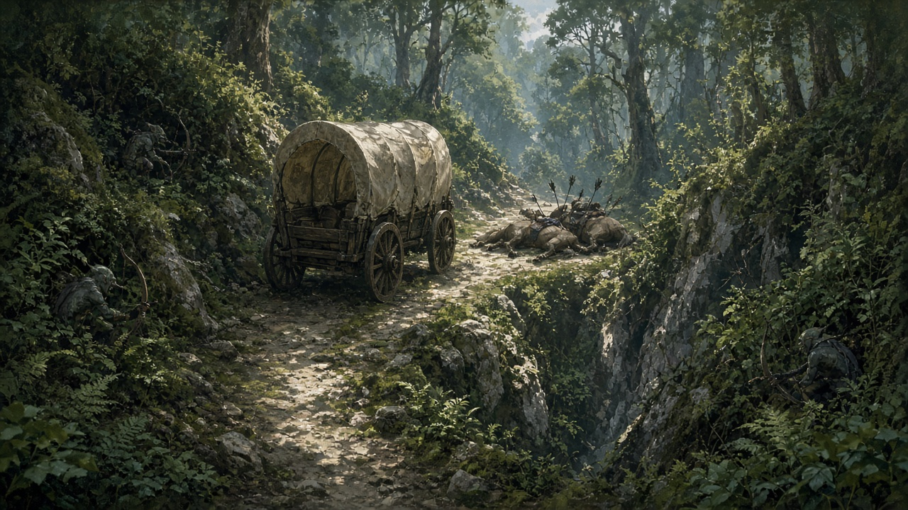

# 02 — Emboscada

Antes da curva, deixa [a senda](../laminas/paisagens/l-senda.jpg). Quando o caminho aperta, troca para [o barranco](../laminas/paisagens/l-barranco.jpg). Portada do bloco: [c-emboscada.jpg](../laminas/portadas/c-emboscada.jpg).

Meio-dia. Senda de Triboar. Bosque fechado, barranco dos dois lados.

**Muestra** a lámina do encontro. O rosto de um goblin, se quiseres um close: [p-goblin.jpg](../laminas/personagens/p-goblin.jpg).

## Ler em voz alta

> El camino dobla y se estrecha. A unos quince metros, dos caballos muertos cortan el paso. Llevan flechas de pluma negra. Hace un día que cayeron. El bosque no deja ver más allá de las zarzas.

## O que há

- Os cavalos são de Gundren e Sildar. Mortos há um dia. O tubo de mapas está vazio.
- Quatro goblins, dois de cada lado. Furtividade +6.
- Rola Furtividade de cada goblin contra a Percepção passiva de cada personagem. Quem ficar abaixo está surpreso e perde o primeiro turno.
- Iniciativa normal depois disso.
- Quando três goblins caem, o quarto foge trilha adentro, para o norte.

## Ler quando o último foge

> El último goblin suelta el arco, chilla y se mete en el verde. Detrás de él queda un rastro sucio de talones y de algo que arrastraron.

Sera e as caixas já não estão. Ficam os bois, o carro e dois sacos no mato.

## Se capturarem um goblin

Ele sabe isto, e mente mal:

- Na caverna há menos de vinte.
- Manda o osgo Klarg. Klarg obedece ao rei Grol, no Castillo Cragmaw, umas vinte milhas a nordeste, no Bosque de Neverwinter.
- A Aranha Negra pagou a tribo para caçar o anão Gundren e tirar-lhe o que levasse. O anão e um mapa já vão para Grol.
- A mulher do carro está na sala comum, amarrada a um poste.

## DECISÃO

Para aqui. Abre [perseguir ou abandonar](../decisoes/01-perseguir-ou-abandonar.md).

O relógio da Sera começa agora, em 5. Anota em [00](00-sera-e-relogio.md).
