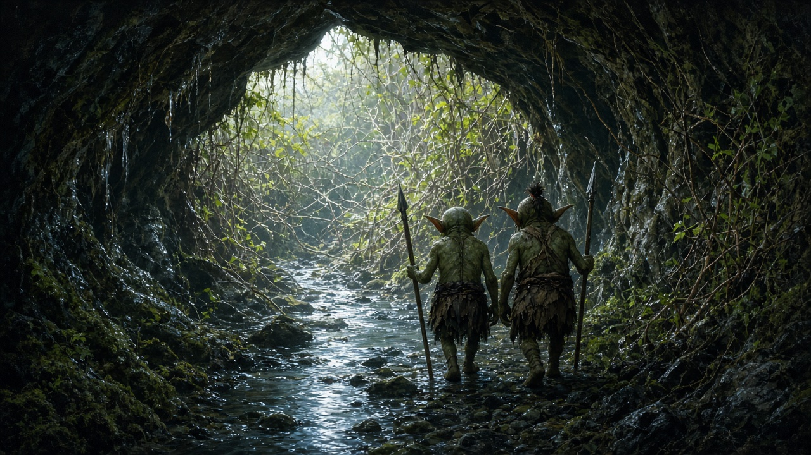
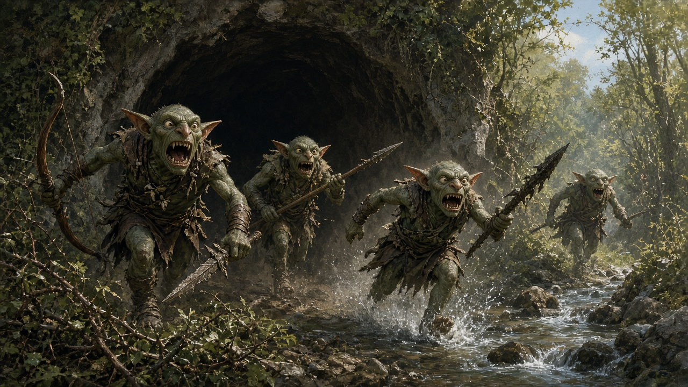

# 04 — Área 1, a boca

Portada do capítulo: [c-caverna.jpg](../laminas/portadas/c-caverna.jpg). Paisagem da boca, ainda sem combate: [l-gruta.jpg](../laminas/paisagens/l-gruta.jpg).

A lámina do encontro depende da decisão. Se ainda não escolheste, abre [sigilo ou alerta](../decisoes/02-sigilo-ou-alerta.md) primeiro.

## Se entram em sigilo



> El arroyo les moja las botas. Dentro, dos goblins caminan de espaldas, hablando bajo, y no se vuelven.

## Se a caverna já está alerta



> La boca oscura escupe goblins. Salen a la luz con arcos y lanzas, y el arroyo se les rompe en las rodillas.

## Mapa rápido

```
Boca e arroio (1)
├─ oeste: vigias no mato (2)
├─ este: perrera (3) —— chaminé de 9 m —— cubil de Klarg (8)
└─ corredor que sobe
   ├─ repecho oeste (4)
   ├─ ponte (5) —— sinal —— tanques (7) —— um goblin corre avisar Klarg
   └─ sala comum (6)  ← Sera e Yeemik
```

As sarças a oeste do arroio são terreno difícil e dão cobertura de três quartos. Se o grupo faz muito barulho aqui, os vigias da área 2 ficam prontos.

## Seguir

- Cruzam para a clareira do leste: [área 2](05-area-2-vigias.md).
- Entram na câmara que cheira a animal: [área 3](06-area-3-perrera.md).
- Sobem o corredor principal: [área 4](07-area-4-pasaje.md).
