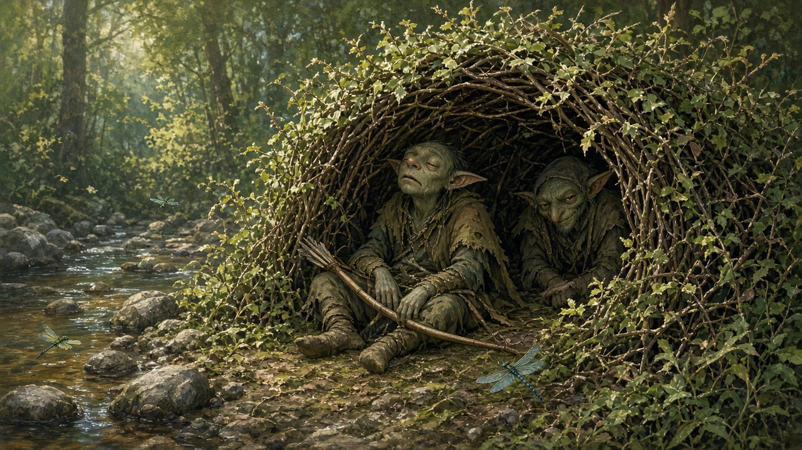

# 05 — Área 2, os vigias

**Muestra** a lámina.

Dois goblins preguiçosos num posto de ramos, na margem leste do arroio.

## Como reagem

- Se o grupo já foi visto na boca, disparam com surpresa.
- Se ninguém os viu antes, eles veem o grupo ao cruzar o arroio. Ninguém fica surpreso.
- Para os surpreender: avançar com cuidado ou vasculhar à frente. Furtividade contra a Percepção passiva dos goblins.

As sarças são terreno difícil e dão cobertura de três quartos.

## Ler em voz alta

> En la orilla este el matorral se abre como una habitación verde. Dentro hay un goblin medio dormido, el arco en las rodillas, y otro que mira el agua sin muchas ganas.

## Seguir

A perrera fica ao lado, área 3. O corredor que sobe leva à ponte. A Sera não está aqui.
