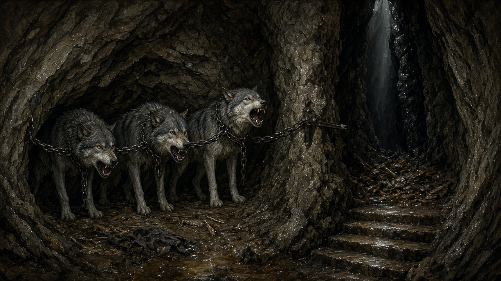

# 06 — Área 3, a perrera

**Muestra** a lámina.

## Ler em voz alta

> Unos escalones bajan a una cámara que huele a pelo mojado y a cadena. Tres lobos tiran de un barrote clavado en una estalagmita. No llegan a los escalones. En la pared este hay una grieta estrecha, babosa, que sube a oscuras.

## Lobos

Atacam qualquer um que não seja goblin e suba os degraus.

- Trato com Animais CD 15 para os acalmar.
- Se lhes derem comida do carro, a CD desce a 10. Então deixam passar.

## A chaminé

Fenda na parede leste. Nove metros até o cubil de Klarg (área 8).

Atletismo CD 10. Sucesso: sobe à metade da velocidade. 5 ou menos: cai 1d6 por cada 3 metros.

Subir por aqui até Klarg **antes** de ver a Sera custa **−1 marca**.

## Se lutam com os lobos à vista da boca

Os goblins de fora não entram. Em cada turno tentam soltar uma corrente: Atletismo CD 15. No primeiro sucesso, a seguinte desce a 10. No segundo, um lobo fica livre.

## Seguir

Voltar ao corredor e subir: [área 4](07-area-4-pasaje.md). Subir a chaminé: [área 8](11-area-8-klarg.md), e marca o relógio.
