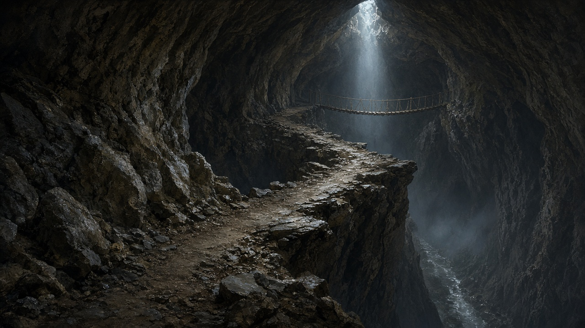

# 07 — Área 4, o pasaje

Enquanto sobem, antes da ponte: [l-corredor.jpg](../laminas/paisagens/l-corredor.jpg).

**Muestra** a lámina do pasaje ao subir.

## Ler em voz alta

> El túnel sube. El arroyo cae a su izquierda en escalones blancos. En la sombra, un corredor se va al oeste. Más arriba, entre las cuerdas y las tablas, hay algo que no debería aguantar el peso de un niño.

## A ponte na sombra

O goblin da área 5 está escondido lá em cima, distraído. Percepção contra a Furtividade dele para o ver.

Se alguém leva luz, ou não se esconde, ele vê o grupo. Não dispara ainda: corre para leste gritar a inundação. Passa sem ser visto só se a Furtividade dele não supera a Percepção passiva de quem possa olhar.

A lámina da ponte em si está na [área 5](08-area-5-puente.md). Mostra essa quando eles olharem para cima de propósito, ou quando ele se mexer.

## O corredor oeste

Terreno difícil. O repecho entre as duas cornijas aguanta menos de 45 kg. Se parte: Destreza CD 10, 2d6 e caído, ou metade do dano e caído se a salvaguarda passar.

## Seguir

Quem sobe à ponte: [área 5](08-area-5-puente.md). O corredor principal também reparte depois entre a [sala da Sera](10-area-6-sera.md) e os [tanques](09-area-7-tanques.md). Se o relógio está baixo, empurra a mesa para a área 6.
