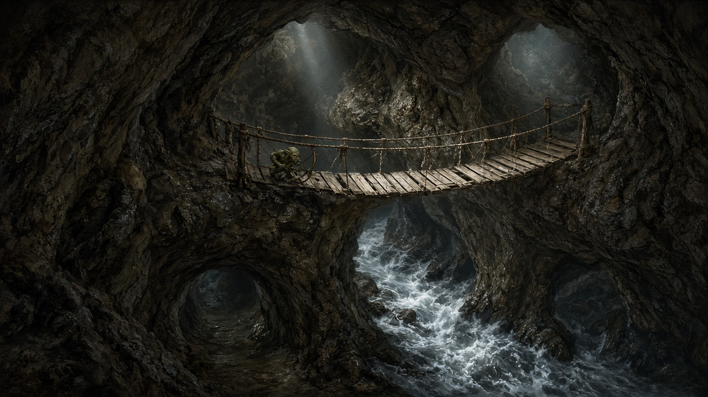

# 08 — Área 5, a ponte

**Muestra** a lámina.

Um goblin vigia. Está distraído. Se não a viram desde a área 4, veem-na agora.

## Ler em voz alta

> Una pasarela de tablas claras y cuerda cruza el vacío, a seis metros del agua. Al otro lado el túnel sigue. Encima de las tablas, casi parte de la sombra, hay un goblin agachado con un arco corto. No parece estar mirando muy bien.

## A ponte

- 6 metros acima do arroio.
- Classe de Armadura 5, 10 pontos de golpe. A 0 parte-se.
- Quem está em cima quando parte: Destreza CD 10, ou 2d6 e caído.
- Descer pela parede: Atletismo CD 15.

## Se o goblin os vê

Grita o sinal para a área 7 e depois dispara. Abre já [os tanques](09-area-7-tanques.md): a inundação começa no turno seguinte ao sinal.

Se o derrubam antes do grito, a água não vem.

## Seguir

Do outro lado do complexo: [Sera, área 6](10-area-6-sera.md) ou [tanques, área 7](09-area-7-tanques.md).
