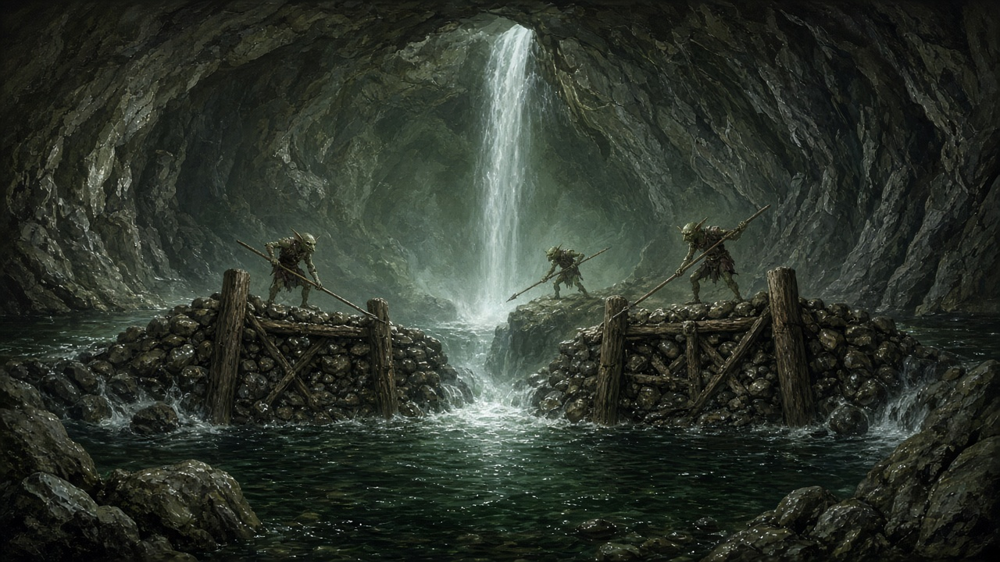
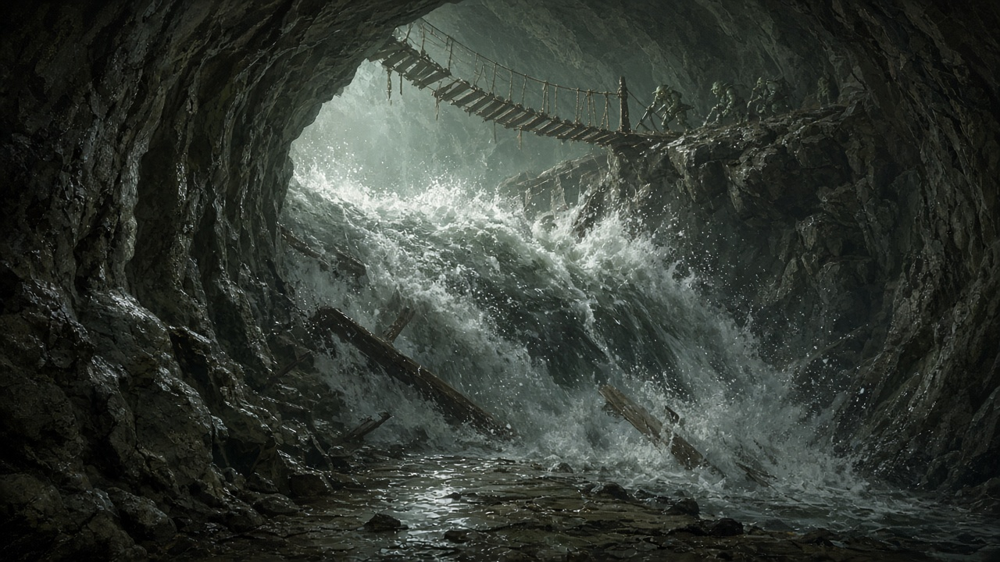

# 09 — Área 7, os tanques

**Muestra** os tanques ao verem a água. A lámina da onda só no turno em que a presa rompe.

Três goblins. Se o da ponte avisou, estão prontos. O ruído da cascata tapa o combate: Klarg não ouve esta sala, e esta sala não ouve Klarg.

No primeiro turno de luta, um goblin corre à área 8 avisar Klarg.

## Ler em voz alta

> El agua cae por una grieta y llena dos balsas negras. Unos diques de piedra suelta las contienen. Tres goblins esperan encima, con las lanzas apoyadas en la roca, como si el muro ya estuviera condenado.

## A inundação

No turno seguinte ao sinal, começam a partir as presas. Na iniciativa dos goblins, no turno de depois, a água desce da área 7 à boca. **−1 marca** se o grupo está no túnel.

**Muestra** a onda e lê:

> El pasillo se llena de un trueno. Una pared de agua negra baja hacia ustedes, alta como un hombre, y se lleva las tablas sueltas por delante.

- Quem está na perrera está a salvo, ou trepa.
- Quem está no corredor ou sobre uma presa: Força CD 10. Se falha, fica caído, vai até a boca e sofre 1d6.
- Se o vigia da ponte não chegou a avisar, uma presa ou as duas já estão vazias e o arroio corre livre.
- O goblin da ponte só pede uma segunda onda se a primeira não limpou o túnel.

## Seguir

Um goblin a correr para leste leva a [Klarg](11-area-8-klarg.md). A Sera, se ainda não a viram, está na [área 6](10-area-6-sera.md).
