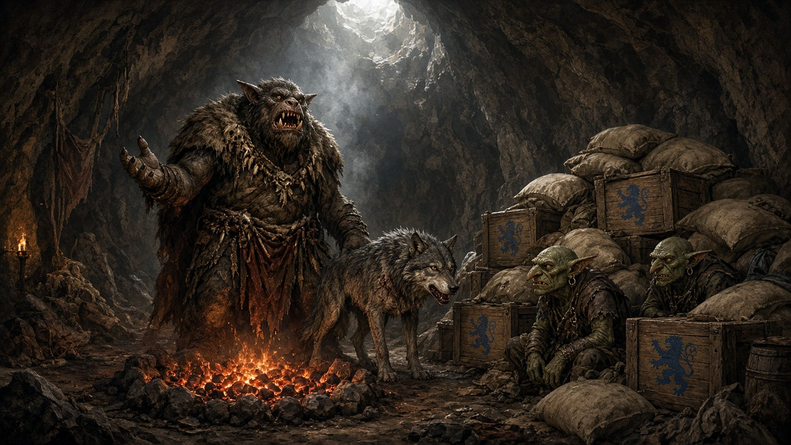

# 11 — Área 8, Klarg

Retrato, no momento em que ele fala: [p-klarg.jpg](../laminas/personagens/p-klarg.jpg). O lobo: [p-rasgador.jpg](../laminas/personagens/p-rasgador.jpg).

**Muestra** a lámina da sala ao entrar.

Se chegam aqui antes da área 6: **−1 marca**. Anota no relógio. Se aceitaram o trato de Yeemik, as −2 marcas desse trato já incluem a ida. Não marques as duas coisas.

## Ler em voz alta

> Brasas en el centro. Sacos y cajas hasta el techo bajo, varias con un león azul pintado. Un osgo enorme habla solo, en tercera persona, como si ya fuera señor de la guerra. A su lado, un lobo lleno de cicatrices. Dos goblins lo escuchan con los dientes apretados. Klarg no es del todo cuerdo, y los goblins lo odian.

## Como está a sala

- Klarg, o lobo **Rasgador**, dois goblins.
- Se a área 7 avisou: Klarg e o lobo esperam atrás dos sacos, cobertura média.
- Se ninguém avisou: boa hipótese de os surpreender. A chaminé que vem da perrera é a entrada que ele não vigia.
- Brasas: 1 de fogo a quem as pisa, 1d6 a quem cai dentro. Uma vez por turno.
- Se Rasgador morre, Klarg foge pela chaminé até a perrera e depois para fora.
- Sacos: cobertura média.

## Tesouro

Num baú, entre os sacos:

- 600 pc
- 110 pp
- 2 poções de cura
- um sapo de jade com olhos de ouro (40 po)

As caixas com o leão azul são do Escudo do León. Linene paga **50 po** se as devolverem em Phandalin.

As caixas da Sera, a farinha e a carne, estão no mesmo monte. Faz falta o carro para as levar.

## Seguir

Se a Sera ainda está no poste, volta à [área 6](10-area-6-sera.md) e aplica o relógio outra vez. Se já a têm, ou se levam o corpo e a carga, põe o carro na estrada e abre [Phandalin](12-phandalin.md).
