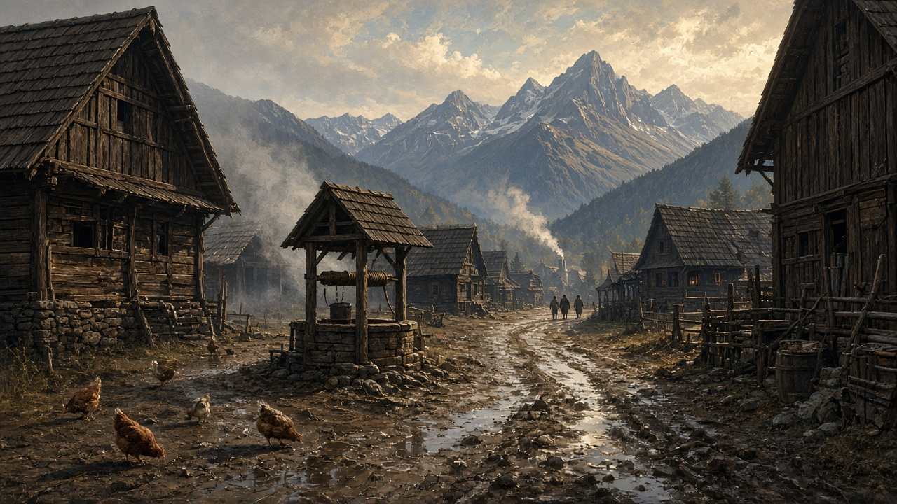
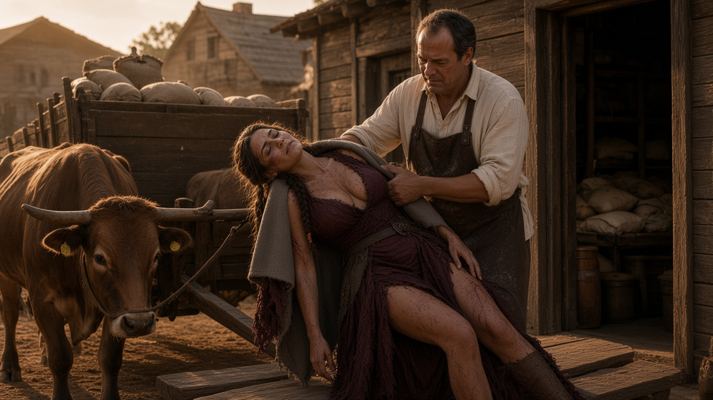
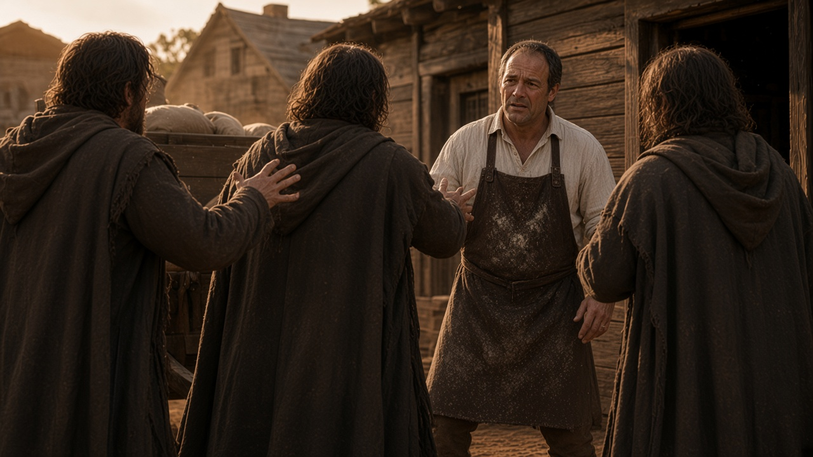

# Phandalin

**Dispara:** se ela vive, [Concerning Hobbits](https://www.youtube.com/watch?v=CL_3mlOPnGI). Sem fundo. Se morreu, [Sadness and Sorrow](https://www.youtube.com/watch?v=_kr7pv2fin8). Se não a trouxeram, [Light of the Seven](https://www.youtube.com/watch?v=6LASz6HAL7E). Nas duas últimas, corta em «Aquí se acaba el camino.»

Lê um bloco só. Viva, com o corpo, ou sem ela. Os três acabam com a mesma frase. No terceiro, para em «¿Dónde está Sera?» e deixa-os falar.

## Se ela vive

> Las colinas se abren. Tejados de madera, humo bajo, luz de tarde. Huele a pan. Después del bosque, el aire está tibio. Las ruedas bajan solas. Nadie tiene que gritar a los bueyes.

Deixa a flauta seguir.

> En la plaza, frente a Provisiones de Barthen, Sera baja del pescante. Le tiembla una rodilla. El vestido burdeos está rasgado, sucio de barro y de sangre seca. No suelta las riendas hasta que el carro se detiene.
>
> Elmar Barthen sale del almacén con una manta gris. Al verla, se queda quieto un instante. Después se acerca, se la pone sobre los hombros y la acompaña hasta la entrada.
>
> —Entrad. Primero agua caliente. Ya habrá tiempo para hablar.
>
> Sera se vuelve hacia él.
>
> —Estos no son simples escoltas. Sin ellos, hoy no habría pan en Phandalin.
>
> Barthen mira a los aventureros y asiente.
>
> —Entonces hoy cenamos todos.

O banho é uma porta fechada. Não descrevas a água.

> Detrás de la posada hay cubos, vapor y una puerta que se cierra. El vestido rasgado se queda sobre un banco. Cuando Sera vuelve a salir, lleva ropa limpia. El cansancio sigue en su cara, pero ya no tiene barro ni sangre en las manos.

> Poco después, empiezan a llegar vecinos a la plaza. Traen bancos, jarras y comida. El pan del carro se reparte entre todos. Alguien empieza a reír y pronto otros se unen.
>
> Barthen se acerca a ustedes. Cuenta diez monedas de oro en cada mano.
>
> —Gundren paga lo prometido. Y esta cena corre de mi cuenta.
>
> Sera levanta su jarra desde una mesa. Por primera vez desde que salieron de Neverwinter, sonríe.
>
> La música, las voces y el olor de la comida llenan la plaza. Las puertas permanecen abiertas. Esta noche, Phandalin celebra.
>
> Aquí se acaba el camino.

## Se ela morreu

Sadness and Sorrow. Não mostres o vale nem o retrato da caverna.

> El viento de la montaña llega a la plaza antes que el carro. Huele a polvo, no a pan. Nadie sale a recibirlos.

> Cuando ven el cuerpo atrás, cubierto con lo que queda de la capa gris, las conversaciones se apagan. Una puerta se cierra. Después otra. En pocos segundos, la plaza queda en silencio.

Deixa o canto ir sozinho.

> Elmar Barthen sale del almacén. Al ver el cuerpo, se quita el sombrero. No pregunta nada. Se acerca al carro y toma las riendas.
>
> Con ayuda de dos vecinos, bajan a Sera y la colocan sobre unas tablas, frente al almacén. Barthen acomoda la capa sobre ella. Alguien trae una vela. Otro deja un pan a su lado.
>
> Nadie habla. Los vecinos permanecen allí, con la cabeza baja, hasta que la vela empieza a consumirse.
>
> Barthen se acerca a ustedes. Cuenta diez monedas de oro en cada mano.
>
> —Gundren prometió pagarles. Y cumplirá su palabra.
>
> Mira una última vez hacia Sera.
>
> —Yo me ocuparé de ella.
>
> El carro se vacía en silencio. Cuando se marchan, la plaza sigue quieta. Frente al almacén, la vela continúa encendida.
>
> Aquí se acaba el camino.

## Se não a trouxeram

Light of the Seven. Começa no piano e cresce. Não mostres o vale.

> El pescante va vacío. En la madera queda un jirón de la capa gris. El carro entra en la plaza cargado de provisiones, pero nadie sale a recibirlos.

> Elmar Barthen aparece en la puerta del almacén. Mira el carro, después las riendas vacías.
>
> —¿Dónde está Sera?

Cala. Deixa-os responder. Depois segue.

> Escucha la respuesta sin apartar la mirada. Cuando terminan, niega lentamente con la cabeza.
>
> —Salió de Neverwinter con ustedes. Les confié el carro y ella tenía que regresar.
>
> Se acerca a los sacos, comprueba que la mercancía está allí y vuelve a mirarlos.
>
> —No voy a pagarles. Y no quiero más problemas en Phandalin.
>
> Dos vecinos se acercan. Uno empieza a descargar las provisiones mientras el otro señala el camino de salida.
>
> Barthen abre la puerta del almacén.
>
> —Dejen el carro. Después, márchense. No son bienvenidos aquí.
>
> Las puertas y ventanas empiezan a cerrarse. Nadie ofrece una cama, comida ni una palabra de despedida.
>
> Cuando abandonan la plaza, el almacén ya está cerrado. El camino de vuelta queda delante de ustedes.
>
> Aquí se acaba el camino.
