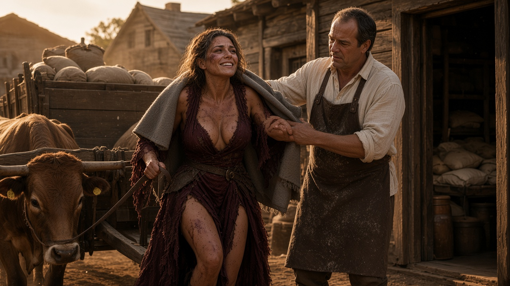

# Phandalin

**Dispara:** se ela vive, [Concerning Hobbits](https://www.youtube.com/watch?v=CL_3mlOPnGI). **Fundo, bem baixo:** [Medieval Town](https://sounds.tabletopaudio.com/56_Medieval_Town.mp3). Se morreu, ou se não a trouxeram, [Tema triste](https://www.youtube.com/watch?v=eV0OZf-dCuw). **Fundo:** [Ghost Town](https://sounds.tabletopaudio.com/208_Ghost_Town.mp3).

Lê um bloco só. Viva, com o corpo, ou sem ela. Os três acabam com a mesma frase. No terceiro, para em «¿Dónde está Sera?» e deixa-os falar.

## Se ela vive

Concerning Hobbits na descida. Quando a faixa acabar, o fundo da vila continua. **Muestra** a portada e o vale antes da primeira frase.

> Las colinas se abren. Tejados de madera, humo bajo, luz de tarde. Huele a pan. Después del bosque, el aire está tibio. Las ruedas bajan solas. Nadie tiene que gritar a los bueyes.

Deixa a flauta seguir.

> En la plaza, frente a Provisiones de Barthen, Sera baja del pescante. Le tiembla una rodilla. El vestido burdeos está rasgado, sucio de barro y de sangre seca. No suelta la rienda hasta que la rueda para.
>
> Elmar Barthen sale del almacén con una manta gris. No pregunta qué pasó. Se la pone sobre los hombros y cierra la tela con las dos manos.
>
> —Entrad. Primero agua caliente. La plaza puede esperar.
>
> Ella habla antes de que alguien llore.
>
> —Estos no son simples escoltas. Sin ellos, hoy no hay pan.
>
> —Lo sé. Por eso hay baño, y después hay cena.

O banho é uma porta fechada. Não descrevas a água.

> Detrás de la posada hay cubos, vapor y una puerta que se cierra. El vestido rasgado se queda en un banco. Cuando salen, el barro ya no está. Huele a jabón y a pan.

Aí a festa.

> Traen bancos a la plaza. El pan que iba en el carro se parte ahí mismo. Se lo pasan de mano en mano. Alguien ríe, corto, y después ríe de verdad.
>
> Barthen no da un discurso. Cuenta diez monedas de oro en cada palma. Cierra los dedos de ustedes sobre las monedas, uno por uno.
>
> —Gundren paga lo prometido. El pueblo paga la cena.
>
> Les ponen una jarra en la mano. Sera está sentada junto al fuego, con una manta sobre los hombros. Por primera vez desde que salieron de Neverwinter, parece tranquila.
>
> La plaza se llena de voces. Las puertas permanecen abiertas y el olor a pan recién hecho se mezcla con el humo de las chimeneas.
>
> Phandalin vuelve a tener una buena noche.
>
> Aquí se acaba el camino.

## Se ela morreu

O tema triste dura perto de dois minutos. A festa que ia haver não acontece. **Muestra** a portada. Não mostres o vale nem o retrato da caverna.

> El viento de la montaña llega a la plaza antes que el carro. Huele a polvo, no a pan. Nadie sale a recibirlos.

> Elmar Barthen se quita el sombrero. Durante unos segundos, no dice nada. Después toma las riendas y se acerca al cuerpo.
>
> Entre dos, bajan a Sera y la dejan sobre unas tablas, frente al almacén. Barthen reconoce su rostro. Le acomoda la capa gris sobre los hombros y le aparta un mechón de pelo de la frente.
>
> Alguien trae una vela. Otro deja un pan a su lado. Nadie lo toca.
>
> Barthen cuenta diez monedas de oro en cada palma. Esta vez no hay agradecimiento ni celebración.
>
> —Gundren pagará lo prometido. Yo me ocuparé de ella.
>
> La plaza permanece en silencio mientras la gente se acerca. Algunas puertas quedan abiertas. Otras se cierran.
>
> Cuando cae la noche, una vela sigue encendida frente al almacén. El carro está vacío. Sera no volverá a conducirlo.
>
> Aquí se acaba el camino.

## Se não a trouxeram

O tema triste, o mesmo. Ele não é o vilão. A vila não tem de acreditar. **Muestra** a portada, não o vale.

> Las ruedas del carro entran en la plaza. Elmar Barthen sale del almacén al reconocer el cargamento. Mira los bultos, después a ustedes.
>
> —¿Dónde está Sera?

Cala. Deixa-os explicar. Ele ouve. Não tem de acreditar.

Se só há a palavra deles, segue daqui.

> La pregunta queda en el aire. Barthen espera una respuesta, pero su expresión cambia mientras escucha. Mira el carro una vez más, como si esperara encontrarla escondida entre las mercancías.
>
> —Ella salió de Neverwinter con ustedes.
>
> Se acerca y revisa el cargamento. Está allí, pero Sera no. Tampoco hay una explicación que consiga tranquilizarlo.
>
> Barthen se aparta.
>
> —No habrá recompensa. Y no quiero problemas en mi pueblo.
>
> Dos vecinos se acercan. Uno señala el camino de salida. Nadie ofrece comida ni alojamiento. Nadie quiere escuchar más historias.
>
> —Marchaos de Phandalin antes de que anochezca.
>
> Las puertas se cierran a medida que cruzan la plaza. El carro sigue lleno de provisiones, pero esta vez nadie sale a recibirlas.
>
> Aquí se acaba el camino.

Se mostram algo dela, a capa rasgada, a pedra do Gundren, ou um goblin que a viu, ele paga as dez e mesmo assim não abre a porta. Lê isto em vez do bloco de cima, a partir de «No habrá recompensa».

> Barthen mira lo que le ponen en la mano. No discute. Cuenta diez monedas, sin cerrarles los dedos.
>
> —Gundren pagará esto. Yo no celebro.
>
> —Marchaos de Phandalin antes de que anochezca.
>
> Las puertas se cierran a medida que cruzan la plaza.
>
> Aquí se acaba el camino.

## Para ti

- Viva: alívio e recompensa. A vila reconhece o esforço e celebra o pão.
- Morta: luto. As dez moedas de Gundren ficam na mão, e a festa não acontece.
- Sem ela: fracasso. Sem prova, não há pagamento nem porta aberta. Com prova dela, as dez moedas, e mesmo assim saem antes da noite.
