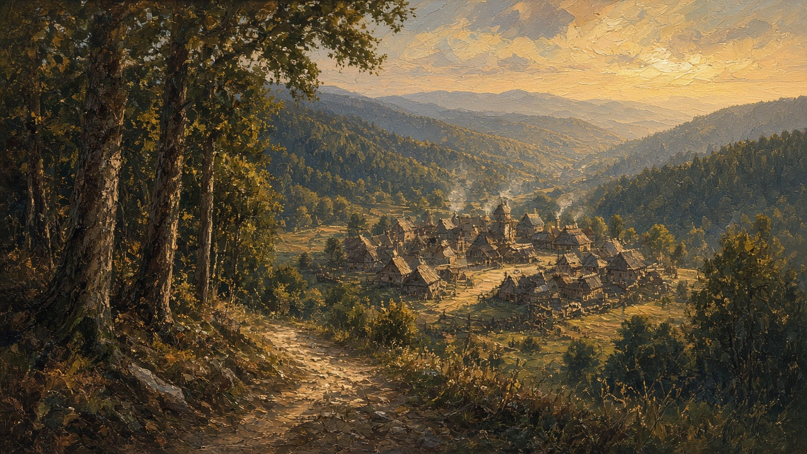

# Phandalin

A praça, conforme a **Sera** venha no pescante ou no carro. Lê só um dos blocos.

## Primeira impressão

**Muestra** a portada e depois o vale.

Se ela vive, **muestra** [Barthen](../laminas/personagens/p-barthen.jpg) na porta.

> Las colinas se abren. Tejados de madera, humo bajo, luz de tarde. Huele a pan. El aire está tibio después del bosque.
>
> En la plaza, frente a Provisiones de Barthen, la gente sale al ver el vestido burdeos, sucio, con la falda abierta en el muslo.
>
> Sera baja del pescante. Le tiembla una rodilla. No suelta la rienda hasta que la rueda para.
>
> Elmar Barthen sale del almacén. Se le queda la boca abierta. Ella habla antes.
>
> —Estos no son simples escoltas. Sin ellos, hoy no hay pan.
>
> Alguien abre la puerta de la posada. Sale olor a estofado.
>
> ¿Entran, o cuentan primero las cajas?

Se ela morreu, não leias o bloco de cima.

> El viento de la montaña llega a la plaza antes que el carro. Huele a polvo, no a pan. Nadie aplaude.
>
> Cuando ven el cuerpo atrás, tapado con lo que queda de la capa gris, las puertas se cierran.
>
> Elmar Barthen se quita el sombrero. Toma las riendas. No los mira.
>
> —Descarguen la comida. Cobren. Váyanse antes de que anochezca.
>
> ¿Bajan las cajas, o se quedan en el pescante?

## O ambiente

- Viva: portas abrem, gente na praça, fumo baixo das cozinhas.
- Morta: as portas fecham-se uma a uma. A praça fica sem voz. O vento continua.

## Pontos de interesse

- **Visível:** a praça, **Barthen**, o carro, ela ou o corpo.
- **Se contarem as caixas:** o que trouxeram do cubil, mais os dois sacos do mato.
- **Se trouxeram as do leão:** a **Linene** aparece depois, sem discurso. Paga **50 po** e assente.
- **Gundren** continua desaparecido. O mapa já não estava no tubo. Uma frase, só se perguntarem.

## Interações

- Entrar na posada, contar as caixas, ou ficar no pescante.
- **Barthen** não os persegue sala adentro. Põe o pagamento na mão.

## Informação do mestre

- **10 po** cada um, viva ou morta, se a carga chega.
- Se ela vive, pode juntar mais **50 po**, baixinho, à porta, se ainda não o disse na caverna.
- Sem as caixas do cubil, ele recebe o que veio no carro. As dez moedas não dependem de um discurso.

## Transição

A história acaba na praça. Se ela vive, a porta da posada fica aberta. Se morreu, o pagamento fica na mão, sem brinde.
