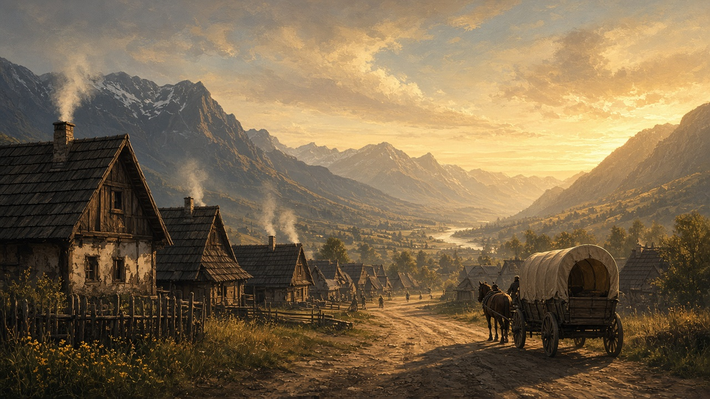

# Phandalin

**Dispara:** se ela vive, [Concerning Hobbits](https://www.youtube.com/watch?v=CL_3mlOPnGI). **Fundo, bem baixo:** [Medieval Town](https://sounds.tabletopaudio.com/56_Medieval_Town.mp3). Se morreu, [Tema triste](https://www.youtube.com/watch?v=eV0OZf-dCuw). **Fundo:** [Ghost Town](https://sounds.tabletopaudio.com/208_Ghost_Town.mp3).

Lê um bloco só. A história acaba com a música. Não há pergunta no fim.

## Se ela vive

Concerning Hobbits na descida. Quando a faixa acabar, o fundo da vila continua. **Muestra** a portada e o vale antes da primeira frase.

> Las colinas se abren. Tejados de madera, humo bajo, luz de tarde. Huele a pan. Después del bosque, el aire está tibio. Las ruedas bajan solas. Nadie tiene que gritar a los bueyes.

Deixa a flauta seguir. **Muestra** a [chegada](../laminas/12-sera-chegada.jpg).

> En la plaza, frente a Provisiones de Barthen, Sera baja del pescante. Le tiembla una rodilla. El vestido burdeos está rasgado, sucio de barro y de sangre seca. No suelta la rienda hasta que la rueda para.
>
> Elmar Barthen sale del almacén con una manta gris. No pregunta qué pasó. Se la pone sobre los hombros y cierra la tela con las dos manos.
>
> —Entrad. Primero agua caliente. La plaza puede esperar.
>
> Ella habla antes de que alguien llore.
>
> —Estos no son simples escoltas. Sin ellos, hoy no hay pan.
>
> —Lo sé. Por eso hay baño, y después hay cena.

O banho é uma porta fechada. Não descrevas a água.

> Detrás de la posada hay cubos, vapor y una puerta que se cierra. El vestido rasgado se queda en un banco. Cuando salen, el barro ya no está. Huele a jabón y a pan.

Aí a festa. **Muestra** a [rua](../laminas/paisagens/l-rua.jpg).

> Traen bancos a la plaza. El pan que iba en el carro se parte ahí mismo. Se lo pasan de mano en mano. Alguien ríe, corto, y después ríe de verdad.
>
> Barthen no da un discurso. Cuenta diez monedas de oro en cada palma. Cierra los dedos de ustedes sobre las monedas, uno por uno.
>
> —Gundren paga lo prometido. El pueblo paga la cena.
>
> Les ponen una jarra en la mano. La plaza no se vacía. El humo de las cocinas sigue. La puerta de la posada se queda abierta, y la luz de dentro llega hasta las ruedas del carro.
>
> Aquí se acaba el camino.

## Se ela morreu

O tema triste dura perto de dois minutos. **Muestra** a portada. Não mostres o vale.

> El viento de la montaña llega a la plaza antes que el carro. Huele a polvo, no a pan. Nadie sale a recibirlos.

**Muestra** a [Sera morta](../laminas/11-sera-muerta.jpg).

> Cuando ven el cuerpo atrás, tapado con lo que queda de la capa gris, las puertas se cierran una a una. La plaza se queda sin voz.

Deixa o canto ir sozinho.

**Muestra** o [Barthen](../laminas/personagens/p-barthen.jpg).

> Elmar Barthen se quita el sombrero. Toma las riendas. No los mira. Entre dos, bajan a Sera y la dejan sobre las tablas, frente al almacén. La capa gris no la cubre entera. Alguien trae una vela. Otro deja, a su lado, un pan que no se parte.
>
> No hay brindis. Hay gente quieta, con el sombrero en la mano, hasta que la cera corre.
>
> Barthen pone diez monedas en cada palma. No cierra los dedos de ustedes. La voz le sale baja.
>
> —La comida queda. Ella, también. Cobren. Váyanse antes de que anochezca.
>
> El carro se vacía en silencio. Cuando miran atrás, la plaza sigue cerrada. En una ventana, una sola vela. El camino está oscuro, y no hay nadie que los llame.
>
> Aquí se acaba.
